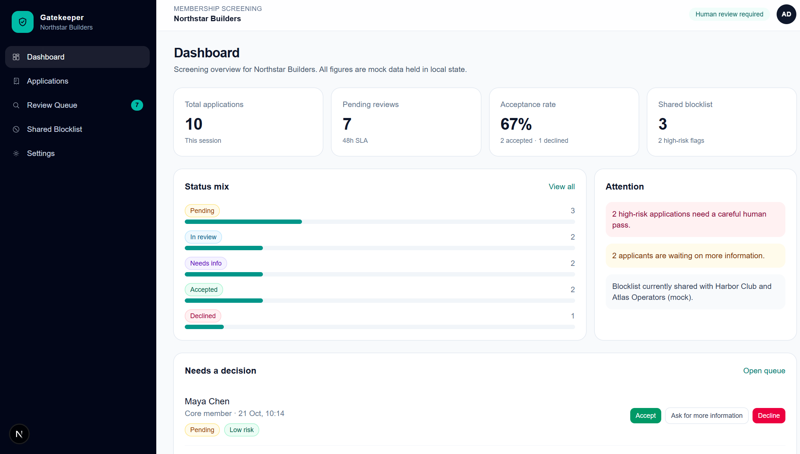
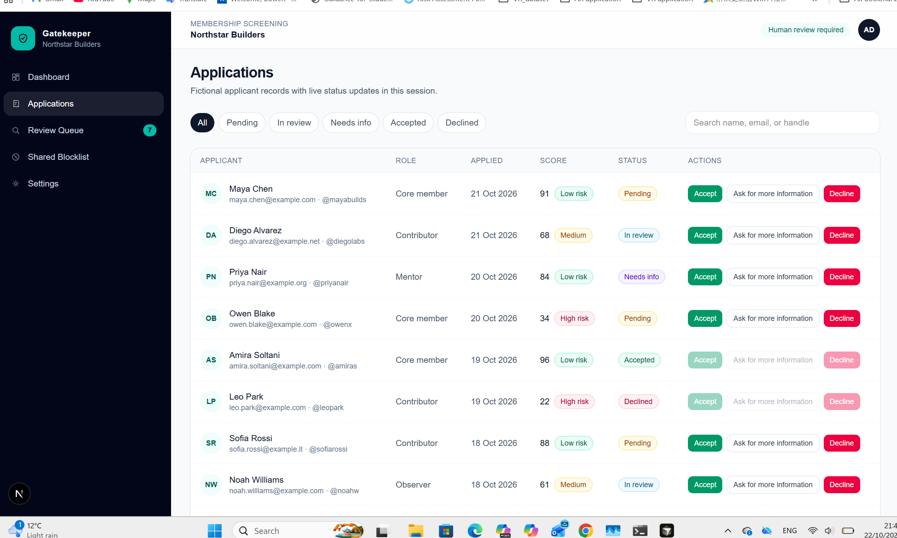
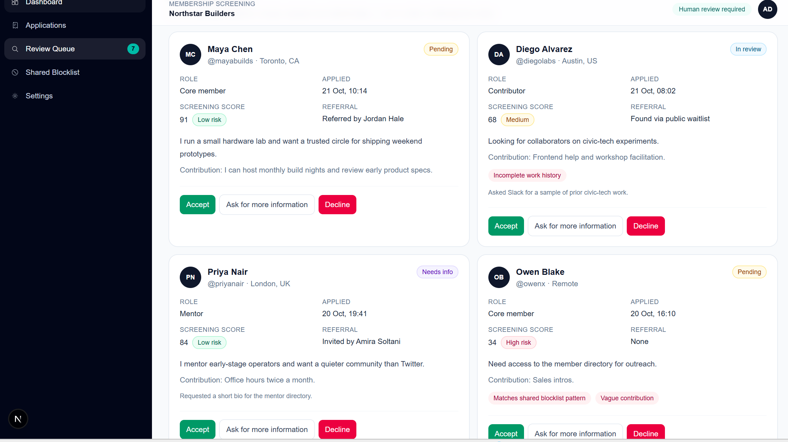
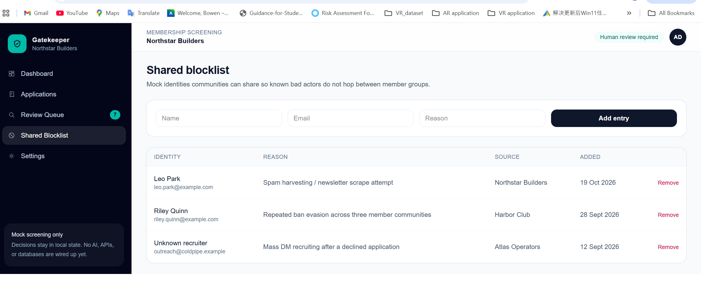
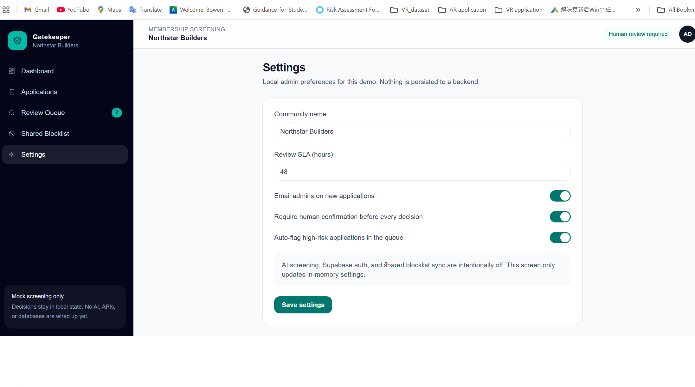

# Gatekeeper

AI-powered membership screening for community admins. This repo is a Next.js dashboard for reviewing join applications, tracking statuses, and maintaining a shared blocklist.

The current build uses **mock data and local React state**. Supabase, external APIs, and live AI screening are not wired up yet.

## License

Released under the [MIT License](LICENSE).

## Stack

- Next.js (App Router)
- TypeScript
- Tailwind CSS

## Run locally

```bash
npm install
npm run dev
```

Open [http://localhost:3000](http://localhost:3000).

## What’s in the dashboard

- **Dashboard** — application stats, status mix, and items that need a decision
- **Applications** — searchable table of fictional applicants
- **Review Queue** — pending human reviews
- **Shared Blocklist** — mock identities communities can share
- **Settings** — local admin preferences

Review actions (**Accept**, **Ask for more information**, **Decline**) require confirmation and update in-memory state for the current session.


## Gatekeeper Demo

Here are screenshots of the Gatekeeper prototype.

### Demo 1


### Demo 2


### Demo 3


### Demo 4


### Demo 5

  
